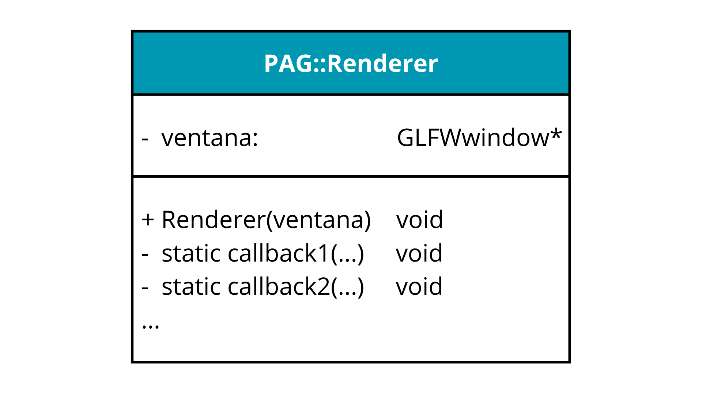
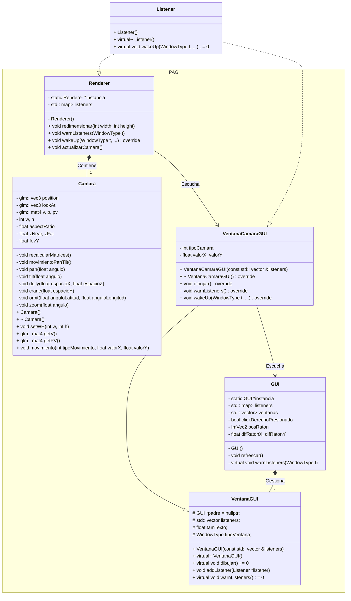
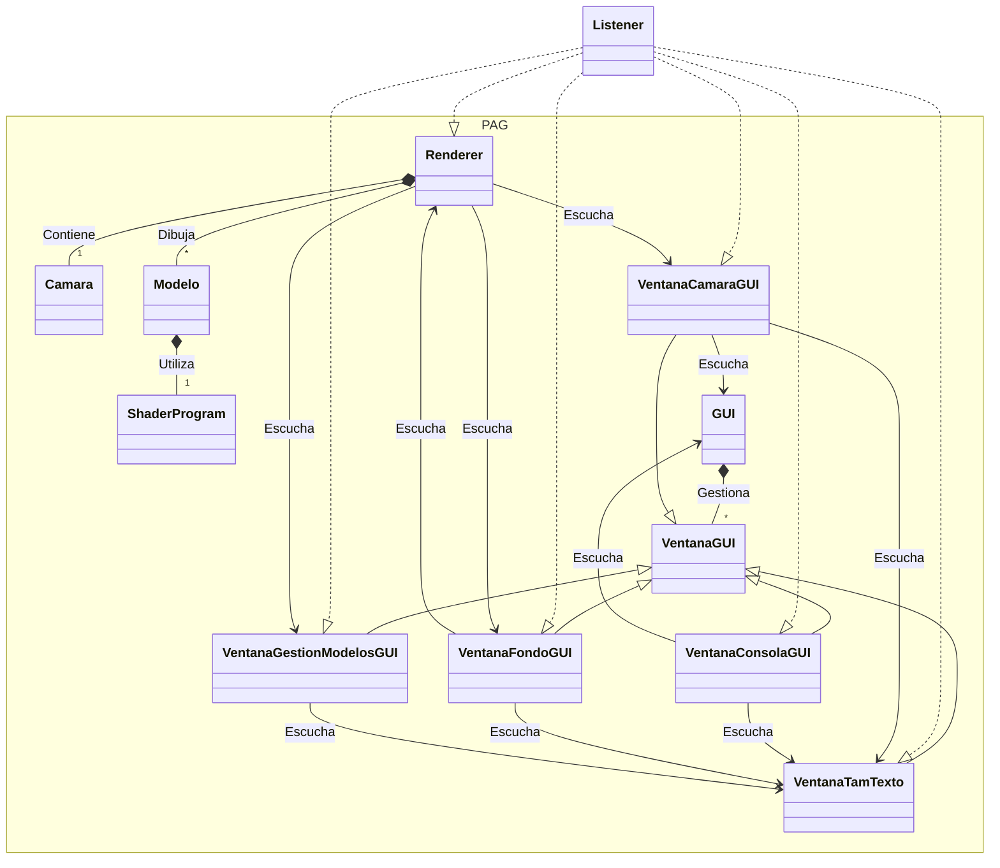

# PROGRAMACIÓN DE APLICACIONES GRÁFICAS

**Santiago Hervás del moral** `shm00025@red.ujaen.es`

---

## Práctica 1 - Configuración

---

### &rarr; Ejercicio de reflexión

El problema planteado se basa en diseñar una clase de C++ que encapsule los métodos relacionados al renderizado de la
escena, con la dificultad de que los métodos de instancia de clase de C++ no se pueden usar como callbacks.

Los métodos asociados a las clases no se pueden usar como callbacks dado que dependen de una instancia de la clase. En C
existen los métodos estáticos, que no dependen de la instancia, sino de la clase en sí, y no pueden contener llamadas a
los métodos o utilizar las variables de instancia. Como las funciones estáticas son independientes, se pueden usar como
callbacks.

El segundo problema surge de cómo desacoplar el uso de esta clase. La existencia de los callbacks está resuelta, pero si
queremos asociarlos a la ventana deberemos realizar cada una de las llamadas y acceder a los métodos de la clase en un
código que no debería conocerlos. Podemos solucionar este problema haciendo que sea la propia clase la que enlace los
métodos con la venta, pasando en su constructor un puntero a ésta.

Finalmente, debería ser inicializado por el main cuando lance el sistema gráfico, dado que la clase contiene los
callbacks de la ventana, y por lo tanto debe definirse al inicio.

A continuación se propone un diseño de esta clase:

[Enlace al diagrama en la carpeta](diagramas/DiagramaUML.png)
---

## Práctica 3 - Primer Triángulo

---

### &rarr; Ejercicio de reflexión

El problema con la deformación del triángulo surge debido a la transofrmación de viewport. Tras el vertex shader,
tenemos un espacio de recorte normalizado, y al aplicarle la transformación de viewport, estas coordenads normalizads se
trasladan a coordenadas de pantalla. Si la pantalla cambia de coordenadas límite (Se redimensiona), el cálculo de las
traslaciones también se ve afectado.

Como propuestas de solución he pensado en alterar el espacio de visión de la cámara, para que este se adapte al viewport
que representa, de manera que si la ventana se alarga, el espacio de visión crezca de manera proprocional, y se mantenga
la dimensión alterada.

---

Tras terminar la práctica y completar el ejercicio opcional, creo que la distrosión de la imagen se debe al uso de un
shader demasiado simple. Al no tener en cuenta transformaciones y considerar las coordenadas como ya normalizadas, el
espacio de recorte depende íntegramente del viewport y por lo tanto, cualquier mínima deformación también deforma el
contenido. Al normalizar las posiciones conseguimos que las proporciones se mantengan desde el espacio normalizado.

---

## Práctica 5 - Cámara

---

### &rarr; Descripción de la implementación

En el siguiente diagrama UML podemos ver la definición de las clases y sus relaciones. Solo se han incluido la
información y las clases que afectan al funcionamiento de la cámara.

El funcionamiento es el siguiente:

- La clase `GUI` captura mediante eventos `IO` las acciones de teclado y pulsaciones de teclas.
- `GUI` avisa entonces a `VentanaCamaraGUI`. Esta clase centraliza la comunicación con la cámara real, agrupando los
  envíos tanto desde `GUI`, como los suyos propios mediante la **interfaz de cámara**.
- `VentanaCamaraGUI` envía la información a `Renderer`, que es uno de sus **listeners**.
- `Renderer` invoca la función de procesamiento de movimientos de `Camara`, que es
  `movimiento(int tipoMovimiento, float valorX, float valorY)`.
- `VentanaCamaraGUI` gestiona internamente los datos, filtrando por el tipo de movimeinto a usar los valores que se
  aplican.

---

## Práctica 6 - Modelos

---

### &rarr; Descripción de la implementación

En el siguiente diagrama UML podemos ver la definición de las clases y sus relaciones. Se muestra el sistema completo en
cuanto a clases y relaciones, pero se han omitido los métodos para mejorar la legibilidad del diagrama.

A continuación justificaré las partes de la implementación que son no triviales.

- La clase `Renderer` tiene una escucha cíclica con la clase `VentanaFondoGUI`, dado que el color de fondo puede ser
  cambiado por ambas, y deben estar actualizadas. Renderer gestiona el cambio en sí del fondo y debe escuchar las
  modificaciones de la ventana. La ventana contiene la paleta, y esta debe cambiar conforme cambie el fondo a efecto de
  los callbacks.
- La clase `Modelo` alberga todo lo relacionado a transformaciones, VAOs, IBOs y VBOs. Es la encargada de dar a **OpenGL
  ** la información de la topología del modelo.
- La clase `ShaderProgram` se encarga del compilado y la ejecución del shader program y los shaders en sí. Un `Modelo`
  tendrá asociado su propio shader program por comodidad. Al establecer esta asociación evitamos la complejidad de un
  sistema de punteros de modelos a shaders, y permitimos la actualización sencilla de las matrices uniformes de GLSL.
  Esta implementación a su vez, deja lugar a expansión, permitiendo crear una estructura de datos y almacenar múltiples
  shaders para diferentes mallas o materiales.
- La clase `VentanaGestionModelosGUI`, antiguamente `VentanaShaderProgramGUI`, se encarga de múltiples tareas lanzando
  hasta tres ventanas. Esta funcionalidad se aleja de la que usan el resto de ventanas GUI de este sistema. La
  diferencia en implementación se debe a la facilidad de mantener un estado compartido, dado que las tres ventanas se
  encargan de la interacción con los modelos, permitiendo mantener una lista mutable de objetos en escena común. Las
  tareas que realiza son las siguientes:
    - Primero de todo, se encarga de pedir el shader que queremos usar por input de texto, y nos solicita que
      seleccionemos un fichero **.obj** mediante un explorador de archivos filtrado a dicha extensión. Hasta que ambos
      valores no se han indicado no se permite la carga del modelo.
    - Cuando hay al menos un modelo cargado, se despliega una nueva ventana con la lista de objetos en la escena, a modo
      de diálogo no modal, que nos da las opciones de borrar el objeto de la escena, o de aplicarle transformaciones.
    - La tercera y última ventana que despliega esta clase es el menú de transformación, que nos solicita los valores en
      cada eje y el tipo de transformación a aplicar. Mientras esté activa se bloquea el uso de las teclas para la
      cámara, facilitando el movimiento entre las entradas, que están filtradas a valores numéricos.
- Las clases `Renderer` y `GUI` únicamente se encargan de la orquestación y despliegue de la aplicación, pero la
  funcionalidad en sí queda relegada al conjunto de objetos que manejan.